# ShopSphere

ShopSphere is a Flutter shopping catalogue built for the **Prosessed Flutter Developer Intern Technical Assignment**. It uses the **DummyJSON REST API** for authentication, product discovery, search, categories, product details, customer reviews, profile data, and simulated checkout.

The app focuses on responsive Material 3 UI, feature-first architecture, Riverpod state management, secure authentication, robust API error handling, local persistence, automated token refresh, and automated testing.

**Android Release APK:** `build/app/outputs/flutter-apk/app-release.apk`  
**Demo Video:** Add Google Drive link before submission  
**GitHub Repository:** [avinashgarlaa/ShopSphere](https://github.com/avinashgarlaa/ShopSphere)

---

## 1. Title & Overview

### User Journey

```text
Splash
  │
  ├── Valid session ───────────────► Home
  │
  └── No valid session ────────────► Login
                                      │
                                      ▼
                              Product Catalogue
                              │      │      │
                    Search / Filter / Sort
                              │
                              ▼
                       Product Details
                              │
                              ▼
                         Add to Cart
                              │
                              ▼
                            Cart
                              │
                              ▼
                          Checkout
                              │
                              ▼
                       Order Confirmation

Profile ──► View User ──► Logout
```

ShopSphere uses DummyJSON as the public backend. No custom backend is required.

---

## 2. Screenshots

### Phone Screenshots

| Splash | Login |
|---|---|
| 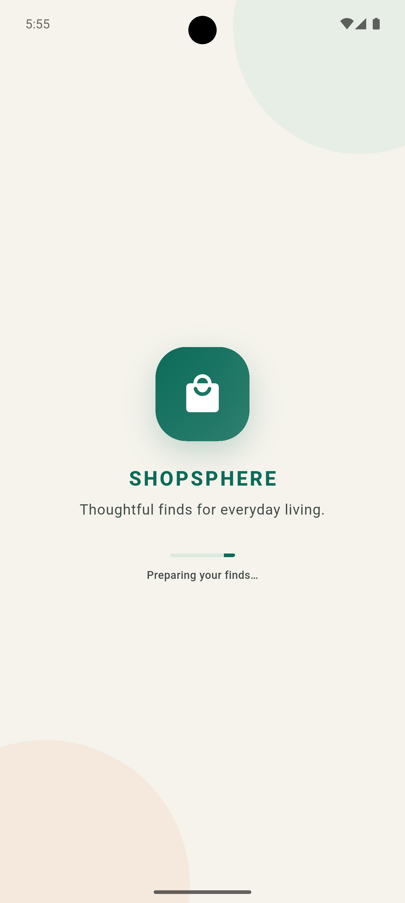 | 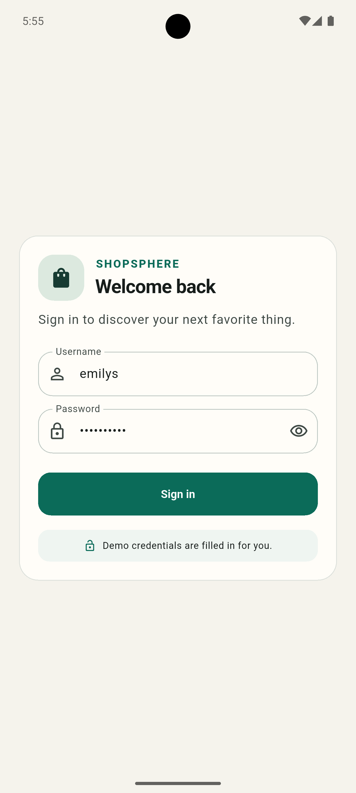 |

| Product Catalogue | Product Details |
|---|---|
| 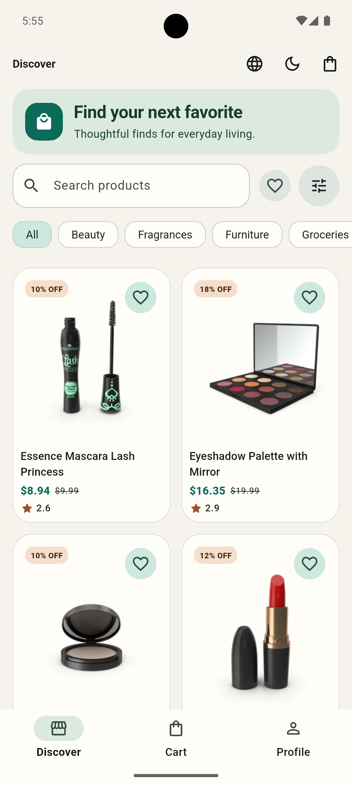 | 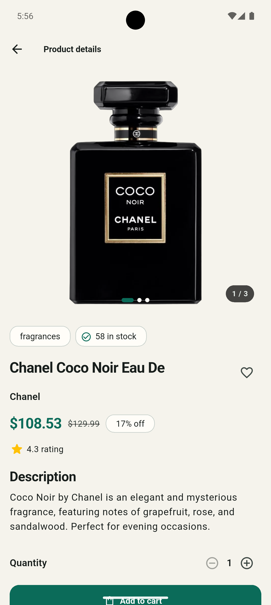 |

| Product Details & Reviews | Cart |
|---|---|
| 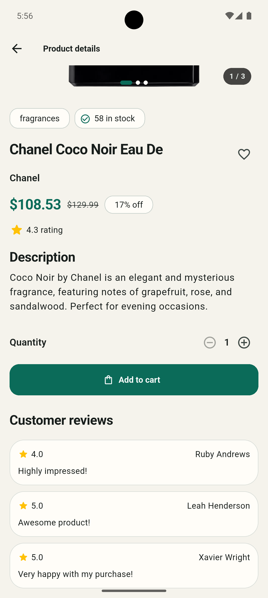 | 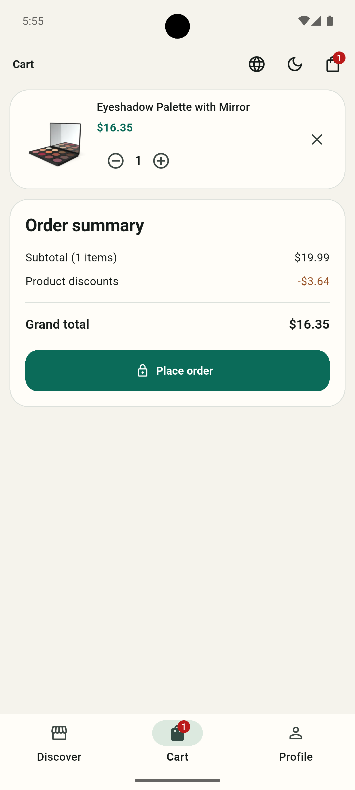 |

| Cart with Added Confirmation | Profile |
|---|---|
| 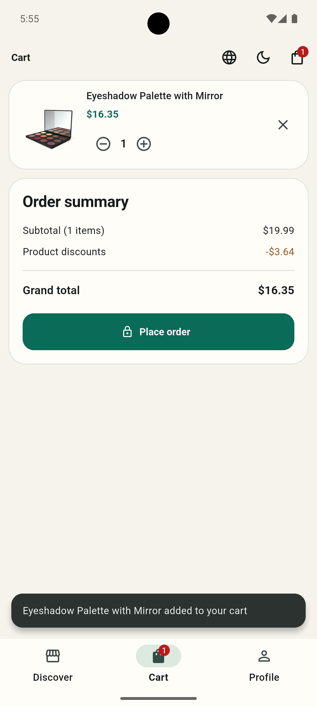 | 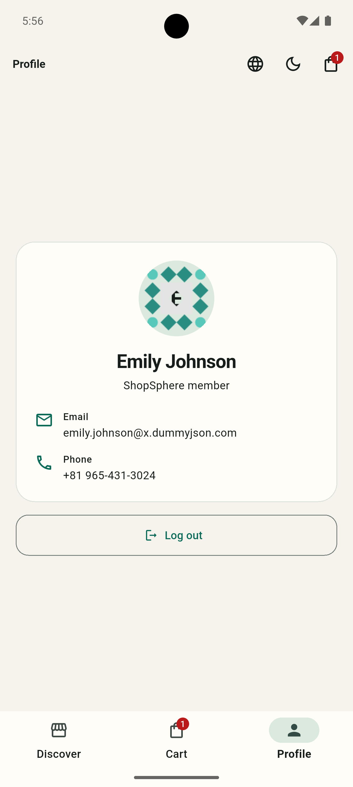 |

### Tablet / Landscape Screenshots

| Splash | Login |
|---|---|
| 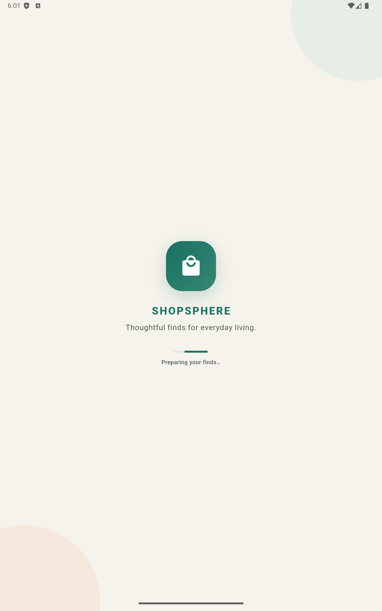 | 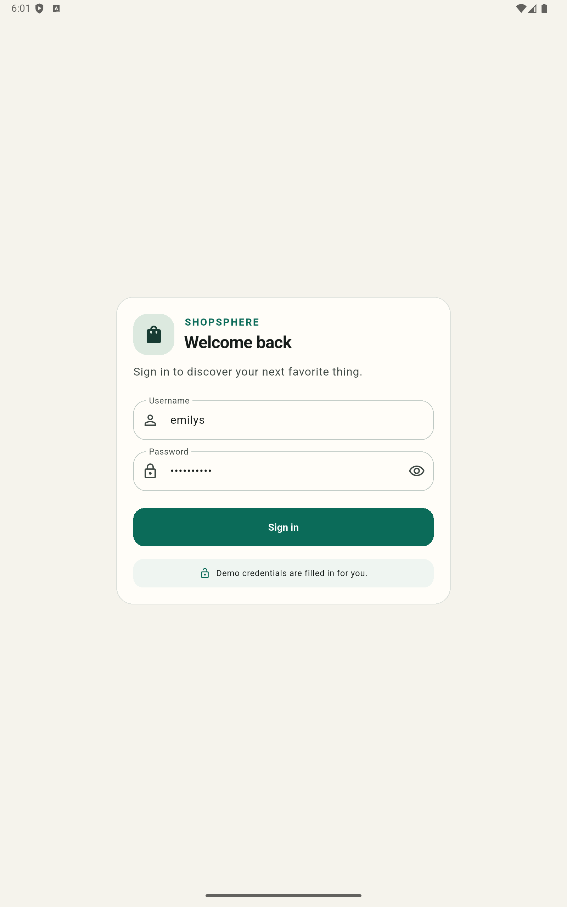 |

| Product Catalogue | Product Details |
|---|---|
| 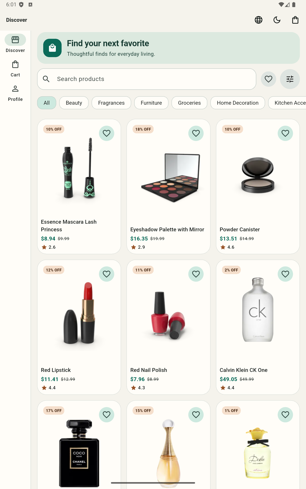 | 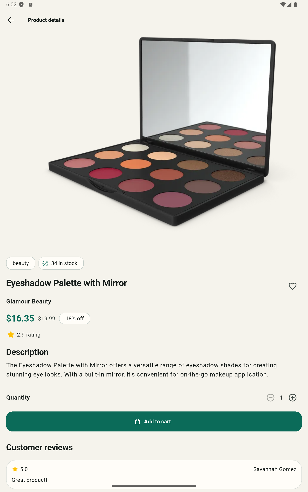 |

| Cart | Profile |
|---|---|
| 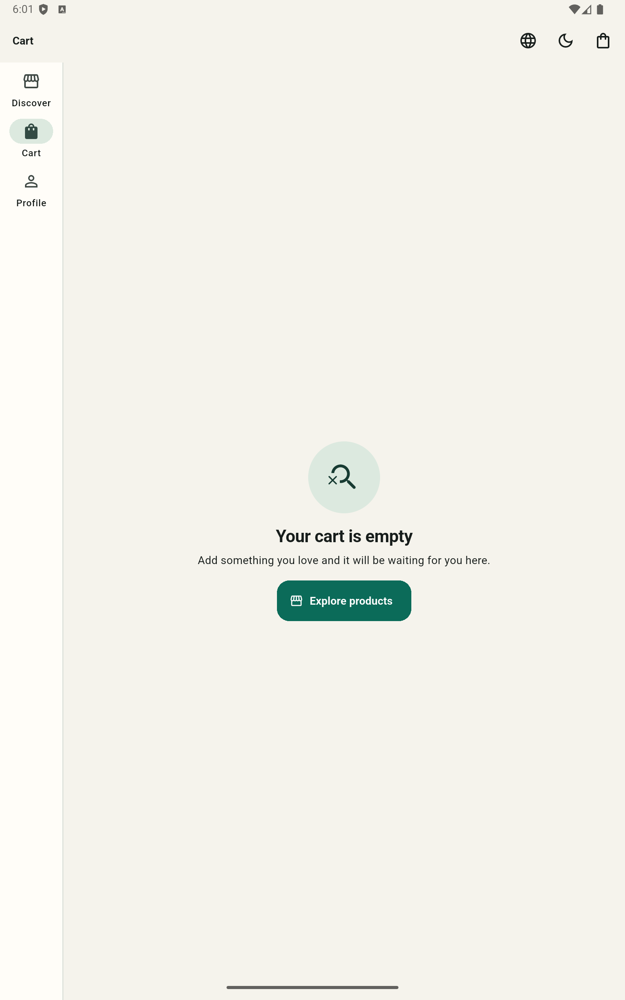 | 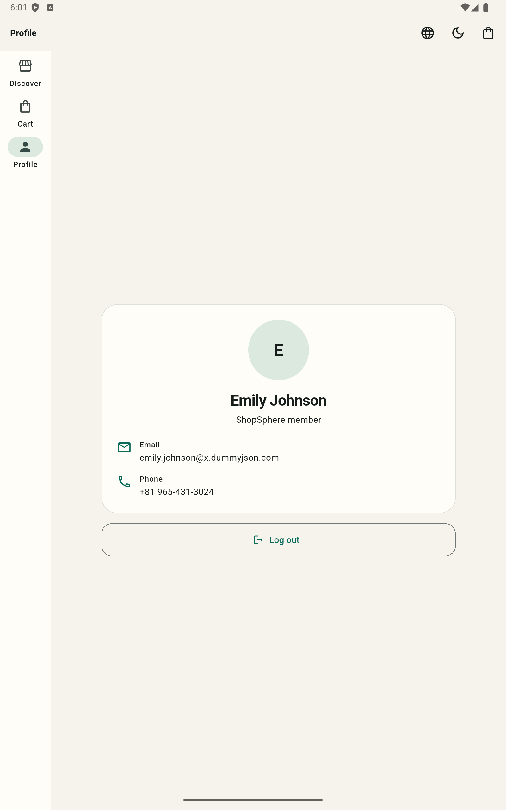 |

---

## 3. Features

### Mandatory Requirements

- [x] Splash screen with persisted secure sign-in session
- [x] Login validation
- [x] Password visibility toggle
- [x] Login loading feedback
- [x] Friendly invalid-credential errors
- [x] Responsive product grid
- [x] API-driven categories
- [x] Debounced product search
- [x] Product sorting
- [x] Pull-to-refresh
- [x] Infinite-scroll pagination
- [x] Skeleton loading states
- [x] Empty results state
- [x] Retryable API failures
- [x] Product image carousel
- [x] Product rating and brand
- [x] Price and discount information
- [x] Stock status
- [x] Quantity selector
- [x] Customer reviews
- [x] Graceful product-not-found state
- [x] Locally persisted cart
- [x] Cart quantity updates
- [x] Cart item removal
- [x] Real-time cart badge
- [x] Subtotal, discount and grand total
- [x] Simulated checkout
- [x] Checkout success confirmation
- [x] Profile loaded from `/auth/me`
- [x] Manual logout
- [x] Forced logout after unauthorized profile response
- [x] Light/dark theme preference persistence
- [x] Compact, medium and expanded responsive layouts

### Bonus Features

- [x] Automatic access-token refresh
- [x] One-time request retry after token refresh
- [x] Failed refresh clears the secure session
- [x] Persisted wishlist
- [x] Cached product pages
- [x] Offline banner
- [x] Persisted English/Hindi selection
- [x] Widget test
- [x] GitHub Actions checks
- [ ] Device/emulator screenshots
- [ ] Error-scenario recording
- [ ] Final release APK upload

---

## 4. Tech Stack

| Technology | Purpose |
|---|---|
| **Flutter 3.44.0** | Cross-platform mobile application framework |
| **Dart 3.12.0** | Application programming language |
| **flutter_riverpod** | State management and dependency injection |
| **Dio** | HTTP client, timeouts, interceptors and API communication |
| **flutter_secure_storage** | Secure storage for access and refresh tokens |
| **shared_preferences** | Local cart, theme, language, wishlist and cache persistence |
| **cached_network_image** | Network image caching with loading/error placeholders |
| **intl** | Locale-aware currency formatting |
| **flutter_test** | Unit and widget testing |
| **mocktail** | Mocking repositories and dependencies |
| **GitHub Actions** | Continuous integration |

### Why these packages?

- **Riverpod** keeps business logic and dependencies outside widgets.
- **Dio** provides a centralized HTTP client with interceptors and timeout handling.
- **flutter_secure_storage** protects authentication tokens using platform secure storage.
- **shared_preferences** provides lightweight persistence for local application state.
- **cached_network_image** improves image loading and provides placeholders/errors.
- **mocktail** allows repositories and dependencies to be isolated during testing.

---

## 5. Architecture

ShopSphere follows a **feature-first, clean-architecture-inspired structure**.

```text
lib/
├── core/
│   ├── network/
│   ├── error/
│   ├── storage/
│   ├── theme/
│   ├── utils/
│   └── widgets/
│
├── features/
│   ├── auth/
│   │   ├── data/
│   │   ├── domain/
│   │   └── presentation/
│   │
│   ├── products/
│   │   ├── data/
│   │   ├── domain/
│   │   └── presentation/
│   │
│   ├── cart/
│   │   ├── data/
│   │   ├── domain/
│   │   └── presentation/
│   │
│   └── profile/
│       ├── data/
│       ├── domain/
│       └── presentation/
│
├── app.dart
└── main.dart

test/
└── features/
```

### Product Request Data Flow

```text
ProductsScreen
      │
      ▼
ProductsController
      │
      ▼
ProductsRepository
      │
      ▼
ApiClient / Dio
      │
      ▼
DummyJSON API
      │
      ▼
Product Model
      │
      ▼
Result<ProductsPage>
      │
      ▼
ProductsState
      │
      ▼
ProductsScreen
```

The presentation layer does not directly instantiate repositories or communicate with the HTTP client.

---

## 6. State Management

ShopSphere uses **Riverpod** for state management and dependency injection.

Riverpod manages product, cart, authentication/session, theme and navigation-related state while keeping repositories outside widgets.

Business rules such as pagination, debounced search, cart persistence and session transitions are handled by controllers rather than UI widgets.

Async states are modeled explicitly using small result/failure types instead of generated unions. This avoids code generation and keeps state transitions visible, although it requires maintaining those transitions manually.

---

## 7. Error Handling

API communication is centralized through a configured `Dio` client.

The network layer handles:

- Network connection failures
- Request timeouts
- HTTP validation errors
- HTTP 401 authorization errors
- HTTP 403 refresh failures
- HTTP 404 not-found responses
- HTTP 5xx server errors
- Parsing/model errors
- Unknown failures

Low-level exceptions are mapped to typed `Failure` objects.

Repositories expose API results through:

```text
Result<T>
```

rather than exposing raw Dio exceptions to the presentation layer.

### Authentication Error Flow

```text
API Request
    │
    ▼
Attach Access Token
    │
    ▼
Response
    │
    ├── Success ───────────────► Return Data
    │
    └── 401
         │
         ▼
    Refresh Token
         │
      ┌──┴───┐
      │      │
   Success  Failure
      │      │
      ▼      ▼
 Retry     Clear Session
 Once          │
      │        ▼
      ▼      Login
  Response
```

Unauthorized requests trigger a serialized token refresh and one retry.

If token refresh fails, secure tokens are cleared and the application returns to the login screen.

Network-driven screens provide loading, success, empty and error states with retry actions where appropriate.

---

## 8. Getting Started

### Prerequisites

- Flutter 3.44.0 or compatible stable Flutter SDK
- Dart 3.12.0
- Android SDK
- Android device or emulator
- Android 8.0 / API 26 or higher

### Clone the Repository

```bash
git clone https://github.com/avinashgarlaa/ShopSphere.git

cd ShopSphere
```

### Install Dependencies

```bash
flutter pub get
```

### Analyze the Project

```bash
flutter analyze
```

### Run Tests

```bash
flutter test
```

### Run the Application

```bash
flutter run
```

No code generation is required.

### Build Release APK

```bash
flutter build apk --release
```

The Android minimum SDK is **26 (Android 8.0)**.

> The current local release configuration uses the debug signing key as a development convenience. A private release keystore should be configured outside source control before distribution.

---

## 9. Testing

Run the complete test suite:

```bash
flutter test
```

Generate coverage:

```bash
flutter test --coverage
```

Coverage output:

```text
coverage/lcov.info
```

### Current Test Suite

**38 tests passing**

The tests cover:

- Repository success paths
- Repository server failures
- Repository network failures
- Not-found responses
- Login validation
- Password visibility
- Compact-screen text scaling
- Splash timing
- Session routing
- Product JSON parsing
- Cart JSON parsing
- Cart calculations
- Product sorting
- Controller loading states
- Controller failure states
- Controller loading-to-success state sequence
- Stale-request handling
- Theme, language and wishlist persistence
- Offline product-cache fallback
- Authentication-header attachment
- Widget behaviour

### Coverage

```text
482 / 1,722 lines
28.0% line coverage
```

The optional 60% coverage target has not yet been reached.

### Continuous Integration

GitHub Actions runs:

```bash
flutter analyze
flutter test
```

for pushes and pull requests.

---

## 10. Test Credentials

The following DummyJSON credentials can be used to test the application:

| Username | Password |
|---|---|
| `emilys` | `emilyspass` |

---

## 11. Assumptions & Trade-offs

### DummyJSON

DummyJSON is used as the public backend. Its checkout endpoint simulates order creation and does not provide durable server-side order storage.

### Local Cart Persistence

Cart data is persisted locally because server-side cart operations are simulated and are not durable.

### Authentication

Access and refresh tokens are stored securely using `flutter_secure_storage`.

When an access token expires, the application attempts to refresh it once and retries the original request.

If refresh fails, the secure session is cleared and the user is returned to Login.

### Offline Behaviour

Product data can be cached locally. When network connectivity is unavailable, the application displays an offline indication and can use cached product information where available.

### Localization

English and Hindi are persisted locally for the application's main authentication and shopping flows.

Product names, descriptions and server-provided review text remain in their source language.

### Future Improvements

With additional development time, I would improve:

- Automated test coverage toward 60%+
- Additional widget and golden tests
- More comprehensive integration testing
- More extensive offline synchronization
- Accessibility testing across devices and font scales
- Additional UI micro-interactions and animations

---

## 12. Author

### Avinash 

**B.Tech — Electronics & Communication Engineering**  
National Institute of Technology, Hamirpur

📍 Mandi, Himachal Pradesh, India

📧 **Email:** `avinashgarlaa@gmail.com`

🔗 **GitHub:** [github.com/avinashgarlaa](https://github.com/avinashgarlaa)

🔗 **LinkedIn:** [linkedin.com/in/avinash-garla-35b1b42a0](https://www.linkedin.com/in/avinash-garla-35b1b42a0)
